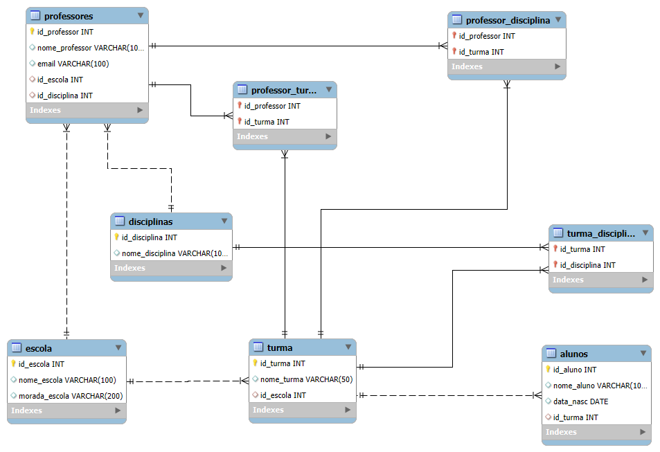

# Commercial Database Design

A relational database project developed using MySQL, focusing on data modeling, table relationships, referential integrity, and SQL queries.

## Database Design

The database represents a simple commercial management system with five tables:

- **Client** — Customer information.
- **Category** — Product categories.
- **Product** — Product information and pricing.
- **Order** — Customer orders.
- **Product_Order** — Junction table connecting products and orders.

Primary and foreign keys establish relationships between tables, including the many-to-many relationship between products and orders.

## Entity Relationship Diagram

## SQL Implementation

The project includes:

- Database and table creation.
- Primary and foreign key constraints.
- Sample data insertion.
- SQL queries using filtering, sorting, JOINs, grouping, and aggregate functions.

## Technologies

- MySQL
- MySQL Workbench
- SQL

## Key Learning
This project reinforced the importance of proper relational database design. A well-structured database helps maintain data integrity, reduces redundancy, and provides a reliable foundation for SQL queries.

This project reinforced the importance of proper relational database design. A well-structured database helps maintain data integrity, reduces redundancy, and provides a reliable foundation for SQL queries.
